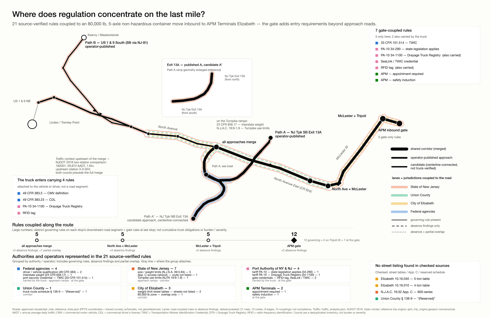

# Last-Mile Drayage Pilot

Research evidence and an experimental assistant for truck access to APM Terminals Elizabeth, New Jersey. The project asks whether a tool-using assistant can give useful, source-supported logistics advice when trip facts are missing and several authorities govern the same movement.

**Start with [the research story](docs/research-progress.md)** for a plain-language account of the experiments, knowledge graph, Neo4j hosting, Claude connection and current results.

This repository contains the retained evidence and the current prototype. The companion [drayage-knowledge-graph repository](https://github.com/itsnotmarvin/drayage-knowledge-graph) provides the same published runtime with a fixed, independently checkable copy of the source evidence.

## Find the work

| Read or inspect | What it explains |
| --- | --- |
| [Research progress](docs/research-progress.md) | Why we built the graph and what the results support |
| [Current prototype status](prototype/knowledge_graph/CURRENT_STATE.md) | What works and which limitations remain |
| [Driver experience](prototype/knowledge_graph/docs/driver-experience.md) | How a trip description becomes a source-supported assessment |
| [Latest validation](prototype/knowledge_graph/audits/evidence-answer-generalization-20260920/README.md) | 473 passing local tests, 11/12 development cases, actual Claude answers and retained failures |
| [Original-failure retest](prototype/knowledge_graph/provider_runs/claude-original-failures-retest-20260919-execution-01/REPORT.md) | Eight exact-prompt responses and why none passed the complete experience criterion |
| [Source registry](data/metadata.json) | Publishers, URLs, dates, archive locations and hashes |
| [Data dictionary](docs/data_dictionary.md) | Record fields and relationship meanings |
| [Neo4j architecture and setup](prototype/knowledge_graph/docs/neo4j-migration.md) | Cloud graph, local service and MCP connection |
| [Publication record](docs/publication-20260920.md) | What was published and how to interpret historical records |

## The scoped evidence

The original movement is a standard five-axle tractor-semitrailer at 80,000 pounds, carrying nonhazardous cargo inbound to the APM gate. Two stored approaches organize the evidence:

- **Path A:** New Jersey Turnpike Exit 13A, North Avenue, McLester Street and Tripoli Street. The southbound approach is operator-published; the northbound Exit 13A connection is a candidate, not verified truck access.
- **Path B:** U.S. Route 1 & 9 southbound, North Avenue East, North Avenue, McLester Street and Tripoli Street.



[Open the map at full resolution](visuals/last_mile_regulation_map.png). Its geometry is schematic, not georeferenced. A stored route or a drawn connection does not establish truck suitability or permission.

The evidence archive includes source documents, official GIS extracts, historical traffic observations and processed records. Exact source quotations, interpretations, effective dates and observation times remain distinct. Mutable bulletins are dated observations; an old notice is not proof of today's conditions. The [traffic report](docs/traffic_analysis.md) explains the historical evidence.

## Current implementation

The evidence graph is hosted in **Neo4j Aura**. The assessment service and Claude MCP connector run locally. The pinned runtime release contains **144 records and 228 relationships**; the older enriched graph visualization contains **121 connected nodes and 345 relationships**.

The prototype retains reported trip facts and corrections, selects relevant source passages, identifies missing information and performs bounded checks using synthetic verification records. The development record includes **473 passing local tests** and **11/12 development cases**. In the latest three-prompt Claude batch, all three used the tool and supplied useful explanations; one answer omitted a supplied date. A fourth targeted regression is recorded separately. These observations do not establish consistently complete consumer answers or a causal improvement over the original study.

## Reproduce local checks

Use Python 3.11 and the declared development dependencies:

```sh
python3 -m venv .venv
source .venv/bin/activate
python3 -m pip install -r prototype/knowledge_graph/requirements-dev.txt
cd prototype/knowledge_graph
python3 -m unittest discover -s tests -v
python3 provider_runs/claude-paired-sealink-20260908/verify.py
```

The local suite uses synthetic fixtures and offline graph evidence; it is separate from a live Neo4j or Claude test. The [Neo4j guide](prototype/knowledge_graph/docs/neo4j-migration.md) describes the separate runtime environment and database setup. Credentials are not included.

Some historical documents refer to a broader root validator and experiment trees that are absent from this publication. Those historical checks are not represented as passing. The publication preserves the available evidence and captured results without inventing missing experiment artifacts.

This is a research prototype. It does not certify a real trip or authorize dispatch, route use or terminal entry. Source-document reuse rights remain with their publishers.
