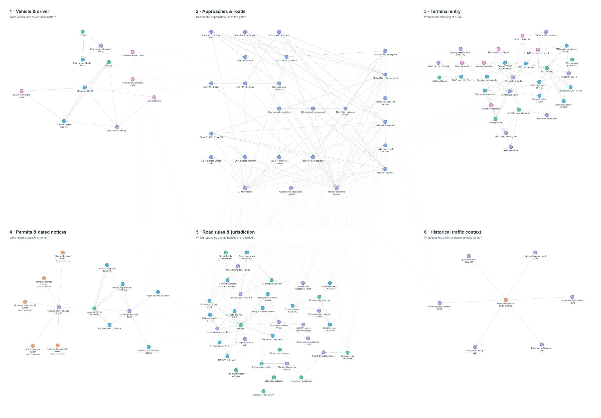

# Last-Mile Drayage Pilot

## Knowledge graph PNG

The `knowledge-graph` branch holds the current graph presentation. Start with
[the full-size PNG](visuals/knowledge-graph.png) and its
[reading guide and scope](docs/knowledge-graph.md).

This repository is the verified evidence base for a multi-jurisdictional study of inbound truck access to APM Terminals Elizabeth. It preserves authoritative physical-network, jurisdictional, regulatory, and terminal-operational data with source provenance.

The scoped movement is a standard five-axle tractor-semitrailer at 80,000 pounds, carrying nonhazardous cargo inbound to the APM terminal gate. The processed corridor routes are:

- Path A: New Jersey Turnpike Exit 13A, North Avenue, McLester Street, and Tripoli Street. The southbound approach is operator-published; the northbound Exit 13A approach is a centerline-connected candidate and is not truck-route verification.
- Path B: U.S. Route 1 & 9 southbound, North Avenue East, North Avenue, McLester Street, and Tripoli Street.

## Repository role

The repository stores evidence and structured data. The coupled knowledge-graph files are one representation of selected records; they are not the entire project. The current static visual is stored as `visuals/drayage_kg_final.png` and reflects the Path A approach status recorded in the processed graph.

`main` contains only retained evidence, provenance, minimal documentation, and structured records suitable for reuse. Draft extraction, alternate scenarios, exploratory GIS work, and unresolved research are kept on `fable-audit-review`.

## Data layout

- `data/metadata.json` — source registry with publishers, dates, URLs, archive paths, and hashes.
- `data/raw/documents/` — archived government, roadway-authority, port, and terminal documents.
- `data/raw/gis/official/` — archived official NJOGIS extracts and service metadata.
- `data/raw/observations/` — archived NJDOT traffic-count observations cited by the source registry.
- `data/processed/vehicle_profiles.json` — the scoped vehicle and movement facts, plus representative drayage truck profiles for rule matching.
- `data/processed/physical_nodes.geojson` — verified route endpoints and intersections.
- `data/processed/physical_edges.json` — ordered, directed roadway corridors for Paths A and B.
- `data/processed/entity_nodes.json` — authorities, jurisdictions, facilities, credentials, and operating systems.
- `data/processed/regulatory_nodes.json` — exact sourced regulatory and operational clauses.
- `data/processed/regulatory_edges.json` — relationships within the regulatory layer.
- `data/processed/coupling_edges.json` — relationships connecting rules and jurisdictions to the scoped vehicle and physical network.
- `data/processed/traffic_analysis.json` — historical station comparison, newer upstream corroboration, corridor operations evidence, limitations, and next-collection requirements.
- `docs/data_dictionary.md` — field definitions and relationship meanings.
- `docs/traffic_analysis.md` and `reports/traffic-analysis/report.html` — reader-facing traffic findings and the portable evidence report.
- `visuals/drayage_kg_final.png` — static knowledge-graph infographic generated from the processed graph counts and Path A approach geometry.
- `visuals/drayage_kg_final2-fixed.png` — prior render of the static infographic, retained for comparison.
- `visuals/editable/` — editable PPTX renders of the knowledge graph with their `.inspect.ndjson` slide inventories.
- `visuals/kg-build/` — build kit for the editable visuals: layouts, jurisdiction SVGs, render outputs, and source notes.
- `visuals/traffic-edit-kit/` — before/after kit for the traffic-corrected slide: template audit, edit script, deviation log, and QA renders.

## Evidence standard

- Archived files are identified in `data/metadata.json` and protected by SHA-256 hashes.
- Regulatory `source_text` is preserved verbatim with a source locator.
- Source statements, applicability classifications, and compliance are stored separately.
- A source may support the broader evidence base without appearing in the final graph visual.
- A map or operational page is used only for the type of fact it actually establishes.
- Unsupported or unresolved claims are not presented as verified data.

## Scope limits

The repository characterizes the selected inbound movement. It does not certify a driver, vehicle, cargo, or trip as compliant, and it does not replace current instructions from the relevant government agency, roadway authority, Port Authority, or terminal operator.
