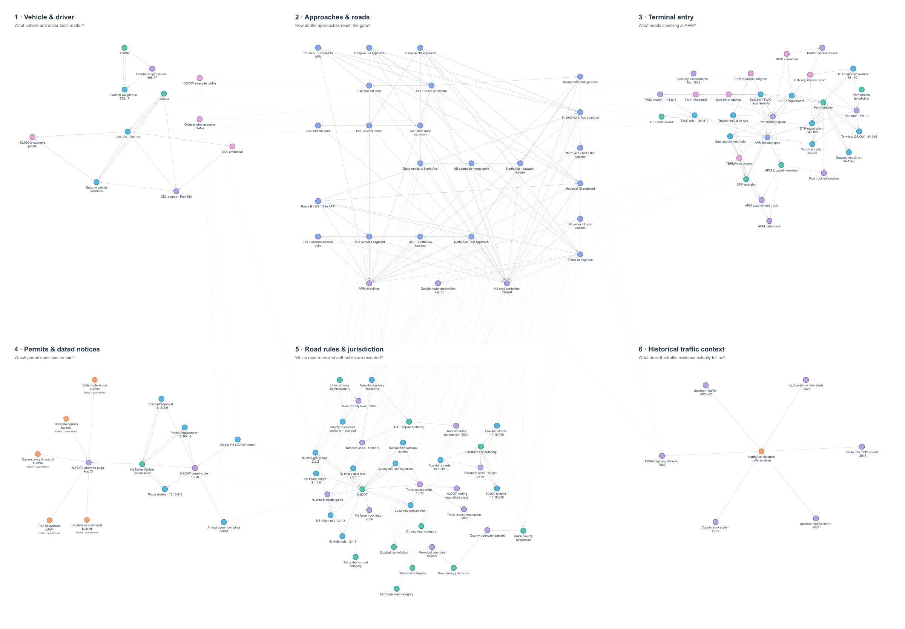

# Drayage knowledge graph

This branch presents the September 7, 2026 PNG snapshot of the connected
knowledge graph: **121 nodes and 345 directed relationships**. The unlinked
2020 Port Authority facilities map is excluded from the image; it remains
retained in the development source inventory.

## How to read the image

Read the top row from left to right: **vehicle and driver**, **approaches and
roads**, then **terminal entry**. The lower row contains **permits and dated
notices**, **road rules and jurisdiction**, and **historical traffic context**.
These topic headings help explain the diagram; they are not graph nodes.

- Purple nodes: source documents.
- Blue nodes: recorded rules and clauses.
- Green nodes: authorities and places.
- Periwinkle nodes: roads, locations and routes.
- Pink nodes: credentials, programs and representative vehicle profiles.
- Orange nodes: dated observations and historical analysis. Dashed nodes are quarantined observations.
- Arrows: recorded relationships. Links between topics are lighter to reduce clutter.

This PNG is a static overview. It does not display every relationship label or
support clicking nodes. View the original image at full size to inspect the names.

## Scope and provenance

The diagram represents archived evidence and illustrative profiles, not a
current trip clearance. A route connection does not establish truck permission;
quarantined observations are not active restrictions. Historical traffic data
cannot establish current congestion or a preferred route.

This is a presentation-only snapshot exported from the separate knowledge-graph
development workspace. The graph builder and its uncommitted evidence updates
are not included in this branch's initial commit. The inherited processed data
in this checkout therefore must not be described as reproducing this exact PNG.
This commit leaves existing repository evidence and earlier visuals unchanged.

Image size: 2400 × 1668 pixels.

PNG SHA-256: `907dea94fe0d02a41b975f24179bf18b73889ff10ab29313937c1c98d38f72a6`.
