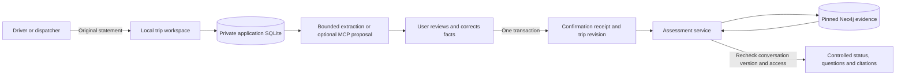

# Integrated driver and dispatcher workspace

Updated September 16, 2026. Implemented local synthetic application; production release
is blocked. This is the current integration guide. Earlier plans and captures
remain historical records. No stakeholder presentation or new Claude wording
experiment was performed.

The application now captures the original statement, obtains explicit review of
proposed facts, owns access to each conversation, and displays a fresh service
assessment with its supporting Neo4j evidence. A model proposal cannot confirm
itself. Confirmation records what the application user reports; it does not
verify the measurement, credential, approval, or legality of the move.

The [reported-fact checks](reported-fact-checks.md) now add source-bound numerical
comparisons, reported prerequisite problems and specific resolution actions to
the assessment. For example, a 175-inch report shows a 13-inch excess over the
retained NJ height reference, separately from the higher terminal reference.
The catalog's 23 draft checks leave legal coverage and operational permission
unchanged. These results render in the local app and controlled export; the
browser acceptance limitation below still applies.

The [individual axle increment](release-engineering.md) adds an explicit
per-axle position/weight editor and report reconciliation. Mixed units are
preserved per row; ambiguous legacy group arrays remain separate. Disputed gross
reports produce no reconciliation difference. Vehicle/trailer changes invalidate
the layout. The final September 13 checkpoint passes 300 local tests and records
27 stdio assessments plus two confirmed HTTP assessments against live Neo4j.
These are backend results; browser and model acceptance remain open.

The [eleven bounded evaluators](requirement-evaluators.md) now consume matching
operator-owned synthetic receipts and display their predicate results and source
supplements. The [September 16 closeout](../audits/evaluator-closeout-2026-09-16/README.md)
preserves the September 15 driver screenshots and corrects the live-capture
environment claim. The screenshots are retrospective evidence, with no original
runtime binding; full browser and model acceptance remain incomplete.

## The implemented flow



- Each user starts a separate conversation for each move. Roles are assigned
  when a synthetic account is provisioned; there is no driver/dispatcher picker.
  The assessed person's role remains an explicit trip fact.
- Conversations belong to an owner and organization. The owner can grant a
  same-organization user view or edit access, remove access, revoke model keys,
  or delete the conversation. Sharing never changes the evidence standard.
- The server stores the exact statement, author, version, timestamp, and SHA256.
  There is no statement-edit endpoint. Corrections are new immutable statements.
- A proposal binds to the latest message and conversation version. The local
  extractor recognizes labeled dimensions, explicit gross weight, limited APM
  destination phrasing, and synthetic aliases. It does not implement general
  language understanding or invent dates, approvals, roles, or credential claims.
- The review form supports every field in the existing intake schema, with
  explicit units and unknown values. It shows prior reports separately. Updates
  affect listed fields; assignment changes invalidate dependent facts. A new
  move must start a new conversation.
- The user compares the original text with proposed values, edits them, checks
  the confirmation box, and submits. The application constructs provenance for
  the confirmed report. It preserves the original proposal, original statement,
  confirmation actor, hashes, and resulting case revision.
- Multiple confirmed corrections are applied in dependency order inside one
  SQLite transaction. Partial corrections cannot survive a later write failure.
  Competing confirmations of the same conversation version cannot both commit.
- A pending new statement suppresses the prior assessment. Assessment requests
  fetch Neo4j evidence afresh and recheck version and access after retrieval.
  Evidence outages return an unavailable result with no cached findings.
- The browser renders server-produced status, questions, confirmed reports,
  scoped findings, source passages, publication/access dates, and separately
  labeled dated observations. It inserts text through DOM text nodes, without
  rendering model HTML or prose as the authoritative result. Results are dated
  snapshots, refreshed on request and periodically while displayed. This is not
  real-time permission or an authority integration.

## Code map

| File | Responsibility |
| --- | --- |
| `trip_app/store.py` | Local identities, sessions, ownership, sharing, immutable messages/proposals, confirmation transaction, deletion and hash-linked audit records |
| `trip_app/extraction.py` | Bounded local suggestions, with unknown/unsupported language left for review |
| `trip_app/service.py` | Capture → propose → confirm → fresh Neo4j assessment; stale result suppression |
| `trip_app/web.py` | Loopback HTTP, strict host/origin, cookie and CSRF boundary, JSON limits, generic failures, local throttling |
| `trip_app/static/` | Browser login, conversation list, statements, typed review, canonical findings, citations and sharing controls |
| `trip_app/mcp_server.py` | Optional two-tool stdio proposal bridge over authenticated loopback HTTP |
| `trip_app/operations.py` | Private files, database/audit integrity inspection, backup and verified restore |
| `trip_app/__main__.py` | Local provisioning, access revocation, serving, check, backup and restore commands |
| `neo4j_kg/trip_state.py` | Existing trip store; now joins a trusted application transaction without changing public MCP arguments |
| `tools/verify_trip_app.py` | Captured local HTTP/stdio integration against live Neo4j; invokes no model |

The historical `kg/` package is unchanged. No NetworkX import or new dependency
was added to the Neo4j/application runtime. The application database is separate
from `.runtime/trips.sqlite3`, which the existing Desktop connector uses. Opening
a legacy trip-only database as an application workspace is rejected.

## Local operation

Run from this prototype directory. The existing `.venv-neo4j` supplies only the
already installed Neo4j/truststore dependencies; no installation is needed here.
Create a private directory first and keep keys out of model chats and audit files.
The following paths are examples for a new synthetic workspace.

```sh
mkdir -m 700 .runtime/local-workspace

.venv-neo4j/bin/python -m trip_app \
  --database .runtime/local-workspace/app.sqlite3 provision \
  --user syn-user-driver --organization syn-org-demo --role driver \
  --key-file .runtime/local-workspace/driver.key

.venv-neo4j/bin/python -m trip_app \
  --database .runtime/local-workspace/app.sqlite3 provision \
  --user syn-user-dispatch --organization syn-org-demo --role dispatcher \
  --key-file .runtime/local-workspace/dispatch.key

.venv-neo4j/bin/python -m trip_app \
  --database .runtime/local-workspace/app.sqlite3 serve --port 8765 \
  --credentials-file /Users/marbin/.config/drayage-mcp/neo4j.env \
  --revision f5dffe0f7a32b5144920efb5a644f8c4dc9f20def76b4217c38b0cdbc454cf5c
```

Open `http://127.0.0.1:8765` and enter the private development key. Access keys
expire after 24 hours; sessions after 12 hours. `issue-access --user ...
--key-file NEW_PATH` creates another temporary key. `revoke-user --user ...`
disables the user and invalidates its keys, sessions, and proposal capabilities.
Keys are random, stored hashed, and written only to new owner-readable files.
The session cookie is HttpOnly and SameSite Strict. Because this is explicit
loopback HTTP, it is not a Secure-cookie/TLS production authentication setup.

The server accepts only `127.0.0.1`, checks the exact Host and Origin, rejects
cross-site requests and malformed/oversized JSON, caps concurrent requests,
and applies process-local request/login limits. It has no public-bind option.
These controls are development boundaries, not a production security review.
The authenticated `/api/health` endpoint reports HTTP request/error counters;
Neo4j availability is established by an actual assessment, not that endpoint.

### Optional Claude proposal bridge

The old five-tool Neo4j connector remains a separate development workflow.
It has not been silently given the application's database or authenticated
confirmation rights. Its known model narration limitations remain relevant.

From a conversation's controls, an authorized editor can create a one-hour
proposal key. Save it in an owner-only file. The separate bridge command is:

```sh
.venv-neo4j/bin/python -m trip_app.mcp_server \
  --origin http://127.0.0.1:8765 \
  --capability-file PRIVATE_CAPABILITY_FILE
```

Its only tools are `get_statement` and `propose_facts`. The model receives the
captured text and allowed fact schema, and returns a proposal bound to that
message/version. It cannot create a user session, change the original statement,
confirm facts, share cases, or issue a clearance through these tools. It does not
receive graph or application database credentials. HTTP redirects and proxy
inheritance are disabled for capability-bearing requests.

No new Claude connector configuration has been applied, and no Claude model has
been invoked for this integration. The app currently runs with the bounded
local extractor unless an operator explicitly connects this restricted bridge.
This is not an end-to-end validated Claude conversational product. Production
must isolate the application service and identity system from model processes;
these local tools are not an OS sandbox against another process running as the
same Mac user. The existing legacy trip-write connector must not become an
alternate path into production application state.

### Recovery and retention

```sh
.venv-neo4j/bin/python -m trip_app --database WORKSPACE_DB check
.venv-neo4j/bin/python -m trip_app --database WORKSPACE_DB backup --output NEW_BACKUP
.venv-neo4j/bin/python -m trip_app --database NEW_RESTORE_DB restore --source BACKUP
```

Backup uses SQLite's consistent backup API and writes a hash manifest. Inspection
checks SQLite integrity, foreign keys, schema version, message/proposal bindings,
confirmation statement hashes, and the audit chain. Restore refuses overwrite,
verifies before copying, and clears all access keys, sessions, model capabilities,
and sharing grants. Operators must reconcile authorization before issuing new
keys, and owners must reauthorize sharing. Source-release recovery is a separate
Neo4j release operation covered by the migration guide.

Owner deletion removes application messages, proposals, confirmations, grants,
capabilities, the underlying trip, and all core request snapshots for that trip.
Hash-only audit events and older backup copies remain. This is logical deletion,
not guaranteed forensic erasure of SQLite/filesystem storage. Production needs
approved retention periods, backup deletion/reconciliation, encryption/key
management and incident procedures. The hash chain detects inconsistencies; it
cannot establish authenticity against someone who can rewrite the whole DB.

## Validation and remaining release gates

The release capture is in `audits/integrated-app-final-2026-09-12/`. Local tests
cover access isolation, sharing/revocation, expiry, CSRF/origin checks, model
capability separation, immutable statements, stale proposals/results, replay,
atomic corrections, concurrent confirmation, redacted failures, source binding,
backup recovery, deletion, and the actual stdio-to-HTTP bridge.

The subsequent [September 13 capture](../audits/reported-checks-final-2026-09-13/README.md)
verifies 273 local tests, 20 source-bound stdio assessments and two new confirmed
HTTP assessments in separate driver/dispatcher conversations. The served
JavaScript matches the captured runtime. The existing Claude Neo4j connector was
restarted for startup/tool discovery only; the restricted proposal bridge remains
unattached and no new model prompt was submitted.

The live capture uses synthetic users and live pinned Neo4j evidence. It checks
identical driver/dispatcher findings, 175-inch extraction, a confirmed 176-inch
correction, explicit sharing and revocation, and rejection of model confirmation.
It is neither a model wording experiment nor a Claude Desktop connector test.

Earlier automation attempts returned `ERR_BLOCKED_BY_CLIENT`. The September 15
synthetic driver walkthrough subsequently reached Describe, Review and Assess;
four existing screenshots are now preserved with hashes and provenance in the
September 16 closeout. They show the original statement, 80000 lb / 175 in
review fields and a conservative assessment. They do not establish the exact
runtime served at capture time, complete action fidelity, dispatcher behavior,
responsive layout, accessibility or model answer fidelity. Those acceptance
items remain open.

Production remains blocked by scope/domain acceptance and complete coverage
of the eleven bounded evaluators; authorized operational evidence/verification; policy
source ownership and change review; production identity, privacy and hosting;
capacity, recovery and incident targets; and held-out acceptance of the actual
released client/model flow. See `production-readiness.md`. These are required
release gates, not optional improvements after a claimed production launch.
